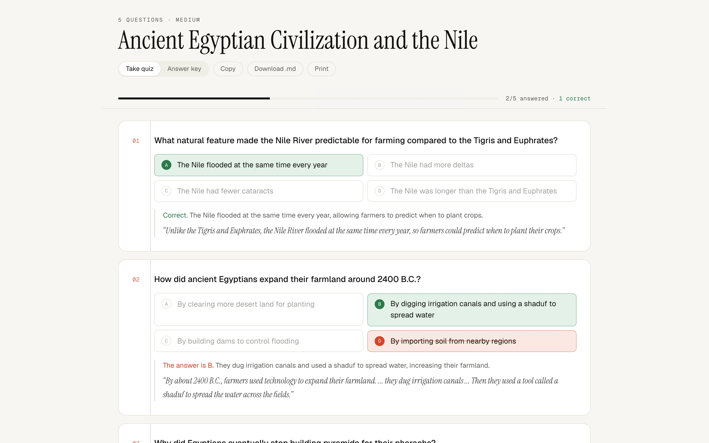

# MCQ Generator

Turn a PDF, a photo of notes or plain text into a graded multiple-choice quiz.


## What it does

- **Any source.** Upload a PDF, a PNG, JPEG or WebP image, or a text file, or paste text. Scanned pages and handwritten notes work too.
- **Grounded questions.** Every question comes from the material, with plausible distractors, an explanation, and a supporting quote from the source.
- **Take it or print it.** Answer in the browser with instant grading, switch to the answer key, or copy, download (.md) or print the quiz.
- **Difficulty.** Easy, medium or hard (elementary, high-school or college level), with 1 to 25 questions.



## How it works

The API sends the material to GPT-4.1 mini with a strict JSON schema. The response is validated: exactly four distinct options, one valid answer, no duplicate questions. Options are then shuffled so the correct answer isn't biased toward one letter.

## Stack

Next.js · TypeScript · Tailwind CSS · OpenAI API · Vercel

## Run locally

```bash
npm install
echo "OPENAI_API_KEY=sk-..." > .env.local
npm run dev
```

---

The original Streamlit version is on the [`legacy-streamlit`](https://github.com/malharinamdar/mcq-generator/tree/legacy-streamlit) branch.
